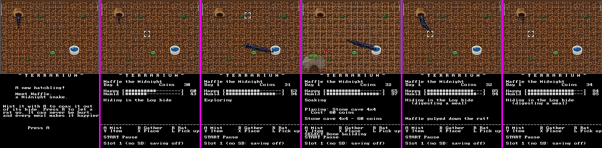

# Terrarium (working title)

A homebrew snake-keeping game for the Nintendo DS Lite and the follow-up to *Groovy Grow*. You build a coco-chip terrarium on the top screen and care for one snake.



## Playing

Copy `Terrarium.nds` to a flashcart, or open it in melonDS. Saves go to `/data/terrarium/slot1-3.sav` on the SD card. If no SD card is found, the game still runs but nothing is saved, and the bottom screen says so.

| Button | Action |
|--------|--------|
| D-pad  | Move the placement cursor |
| A      | Mist the tiles under the cursor |
| B      | Gather shed skin or droppings under the cursor (earns coins) |
| Y      | Choose an item to place (press again for the next item) |
| X      | Place the selected item |
| R      | Release a rat at the cursor |
| L      | Pick up the item under the cursor (full refund) |
| SELECT | Stop building (hides the grid) |
| START  | Pause (save, resume, or save and quit) |

### How it plays
- **Every new save rolls a different snake colour.** There are 12 morphs: Classic, Albino, Banana, Lavender, Axanthic, Pastel, Midnight, Leucistic, Coral Glow, Emerald, Ember and Piebald. A new save never gets a morph another slot is already using. The snake also gets a random name.
- **The snake can never die.** There is no starvation and no overfeeding. Every rat it eats adds +20 happiness, up to 100. Low happiness only makes it sulk.
- **Misting** raises humidity and darkens the misted chips. Once humidity passes 60, the snake leaves its hide to explore, soak in bowls and visit damp spots. When humidity drops below 35, it heads back to a hide and curls up with its tail tip showing.
- **Rats** wander and flee when the snake gets close. The snake creeps up on the rat, coils, pauses, and strikes. After a meal it shows a lump that moves down its body, returns to a hide, and ignores misting until the meal is digested. It still eats any rat you release in the meantime.
- **Gathering:** the snake sheds its skin now and then and leaves a dropping after each meal. Gathering a shed earns 12 coins and a dropping earns 6. A happy snake (50+) also earns 1 coin every 10 seconds. Spend coins on items.
- **Items** (15): log hide and stone cave (both are hides); rock pile, cork bark and corner ledge (solid, and the corner ledge only fits in a corner); water bowl, stone dish and soaking tub (bowls); fern, grass, moss, succulent, monstera, pothos and bromeliad (the snake glides through plants).

## Building

The game uses devkitPro (devkitARM + libnds). With Docker:

```sh
docker run --rm -v "$PWD":/p -w /p devkitpro/devkitarm make
```

### Art
All art is generated by `tools/make_art.py`, which writes `source/art.c`, `include/art.h` and the contact sheet `tools/art_preview.png`. After editing the script, run `python3 tools/make_art.py`, then `make`.

### Tests
- `tests/sim_test.c` runs the game rules on a PC. It simulates hours of random play plus 200 rats fed back to back, and checks that the snake always eats and stays happy.
  ```sh
  gcc -O2 -Iinclude tests/sim_test.c source/game.c source/morphs.c source/art.c -lm -o sim && ./sim
  ```
- `tools/emu_shots.py` plays a scripted session in DeSmuME (`pip install py-desmume`) and saves screenshots. The DeSmuME build bundled with py-desmume can't boot ROMs built with libnds 2.x, so for this script only, build with the older image `devkitpro/devkitarm:20240511`. The code supports both.

## Code layout
- `source/game.c`, `include/game.h`: all game rules (snake AI, rat, humidity, happiness, items, gathering). This code has no DS dependencies.
- `source/main.c`: DS front end. It handles the background layers (floor, grid, tank rim), depth-sorted sprites, the bottom-screen text UI, the title screen and the three save slots.
- `source/morphs.c`: morph palettes and snake names.

## Still open
- **Bottom screen:** it currently shows a text placeholder (stats, the selected item, messages and controls) until its design is decided.
- **Title:** "Terrarium" is a working title.
- **Species and look:** the body is drawn as a generic python-like snake. The morphs only change its colours.
